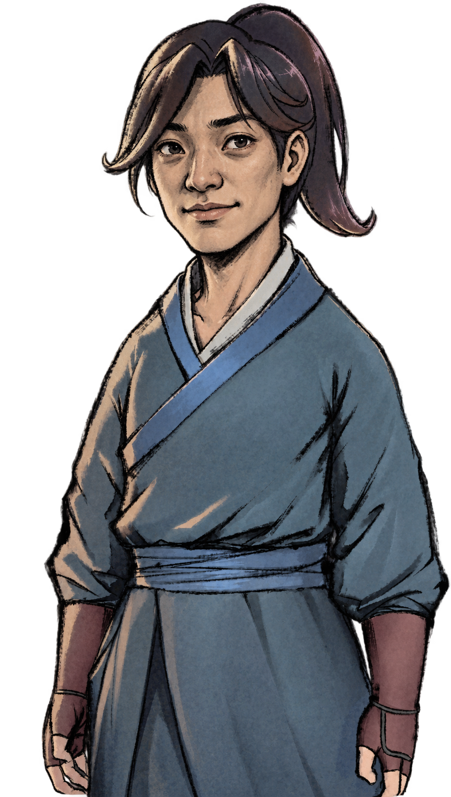

# ZhaoHuo Natural · 赵活自然美化包

为《活侠传》的成人赵活制作的非官方立绘模组。将面容调整为**自然耐看、保留草根侠客气质**的形象，延续原作的灰蓝布衣、束发、护腕与粗笔触画风，也保留各表情的情绪、伤势和动作。

本项目免费提供。美术使用 gpt-image 辅助重绘，以原作立绘为姿态与画风参考；不是官方更新，也不是原画作者的新作。游戏的剧情设定与台词保持原样。

**[下载最新完整安装包](https://github.com/jsdhwfmax/zhaohuo-natural/releases/latest)** · [v1.0.1 发布说明](https://github.com/jsdhwfmax/zhaohuo-natural/releases/tag/v1.0.1) · [安装与卸载](docs/安装与卸载.md) · [常见问题](docs/常见问题.md)

**旧包提示“游戏版本不受支持”？** v1.0.0 只认识 build `25953419`，游戏官方热更新后可能被旧安装器拒绝。请下载新版**完整 ZIP**，退出游戏，解压到**游戏文件夹之外**再运行新的 `Install.cmd`；不要继续使用旧包里的安装器，也不要手动替换游戏 DLL。详见[热更新问题说明](docs/常见问题.md#游戏已经更新为何旧包提示版本不受支持)。

如果此前误把安装包直接解压进游戏目录，也请先将新版完整包解压到外部文件夹运行；安装器会核对是否为原样解压的发行文件，再决定如何处理。不要为绕过提示盲目删除 DLL。见[误解压处理](docs/常见问题.md#已经直接解压到游戏目录怎么办)。

## 覆盖范围

| 内容 | v1.0.1（美术与 v1.0.0 相同） |
| --- | --- |
| 成人赵活表情与动作 | 47 张新立绘，包括日常、负伤及特殊动作 |
| 属性面板 | 两个常态分支均使用新立绘 |
| 成人背影与左右剪影 | 保留原作，共 3 张 |
| 幼年、老年、魔化、门派独立造型 | 保留原作 |
| 战斗小人、剧情 CG、其他角色 | 保留原作 |

部分夸张表情、受击拖影和泥巴马赛克属于原作的演出设计，新图保留这些用途。本包不改变角色剧情中的外貌评价。

## 安装前先看版本

适用平台为 Windows x64、Steam 版《活侠传》（App ID `1859910`），搭配 **BepInEx `6.0.0-be.692`**。v1.0.1 已验证当前“崆峒神威”热更新 build **`25957922`** / **`release_1.0.6000.2`**，并保留原已验证 build **`25953419`** / `release_1.0.6000.0` 的适配。

安装器将四个游戏程序集的完整 SHA-256 指纹组与已验证构建列表匹配，未知组合仍会拒绝。同样显示“崆峒神威”或相同版本名称，也可能包含不同的热更新文件。BepInEx 5 和 IL2CPP 环境不在本版支持范围内。详见[兼容性说明](docs/兼容性与验证.md)。

1. 从上方发布页下载**完整安装包 ZIP**，完整解压到**游戏目录之外**的独立文件夹。GitHub 自动生成的 `Source code` 压缩包供查看源码，不是安装包。
2. 在游戏内保存进度并退出游戏。
3. 双击 `Install.cmd`，在中文窗口中确认游戏位置并进行检查、安装。
4. 安装成功后，从 Steam 正常启动游戏。

完整安装包包含所需依赖，可离线安装。详细操作、备份和回滚方式见[安装与卸载](docs/安装与卸载.md)。纯净游戏与已有加载器的处理由安装器检查决定；不要手工混装不同版本的加载器。

## 已做的验证

在 build `25953419` 与 `25957922` 各自的实际 Unity 进程中，成人目录均为 **50/50 个资源加载成功、47/47 张新图替换成功、属性面板 2/2 个分支通过**。同时检查了同步与异步加载、UI 引用、重复加载缓存及非主角保护。

精简结果可查看[新构建验证 PASS](verification/runtime-build25957922/PASS.txt)、[原构建验证 PASS](verification/runtime/PASS.txt)与[图片完整性记录](verification/art-integrity.json)。

原构建另经普通 Steam 启动确认插件加载、游戏窗口响应，最后由测试用户手动关闭。**这些结果是资源加载与显示链路验证，不是全剧情、全路线通关测试。** 人物关系与角色介绍界面的完整交互流程也未逐一验证。更多边界见[验证说明](docs/兼容性与验证.md)。

v1.0.1 通用安装器在 PowerShell 5.1 的独立模拟游戏目录中通过 **55 项检查**，覆盖完整构建指纹匹配、旧公开包直接检查、误解压文件接管、安装卸载、自动回滚、文件保护与 Steam 多库发现。模拟检查没有安装或运行真实游戏，详见[安装器测试结果](verification/installer-tests.json)。

## 文件与反馈

模组通过 BepInEx 在运行时加载新 PNG，不覆盖游戏原始程序集或资源包。发行包不提供原版游戏资源，需要已安装的 Steam 正版游戏。

- 遇到问题：先看[常见问题](docs/常见问题.md)，再[提交问题](https://github.com/jsdhwfmax/zhaohuo-natural/issues/new/choose)。请说明游戏版本、安装器提示及复现步骤；提交日志前删去个人路径和账号信息。
- 版本变化：[CHANGELOG.md](CHANGELOG.md)。下载与更新统一以本仓库发布页为准。
- 开发资料：[插件源码与构建说明](Source/README.md)、[绘图提示词](Prompts/)、[仓库中的打包脚本](https://github.com/jsdhwfmax/zhaohuo-natural/blob/main/scripts/Build-Release.ps1)。
- 视频制作：[B 站视频讲解稿](docs/B站视频讲解.md)。该文档是讲解素材，不表示视频已经发布。

## 许可与署名

本项目自有代码、原创脚本和文档采用 [MIT License](LICENSE)。美术另见 [ARTWORK-NOTICE.md](ARTWORK-NOTICE.md)：本项目允许其自有美术贡献用于模组使用、修改和分享，原游戏及相关角色、美术的权利仍归各自权利人所有。第三方依赖遵循各自随附的许可证，见[第三方组件声明](THIRD_PARTY_NOTICES.md)。

本项目与《活侠传》开发者、发行方及 Steam 无关联，也未获其官方背书。
