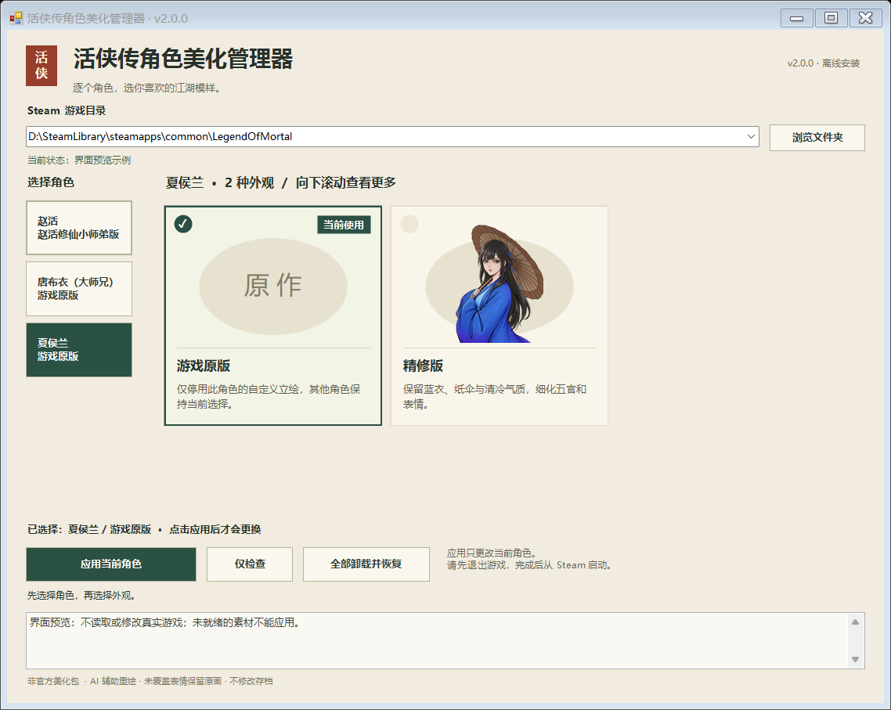

# 《活侠传》角色美化管理器 v2.0.0

在一个离线窗口里，分别为**赵活、唐布衣（大师兄）、夏侯兰**选择外观。赵活有六套形象，另外两位各有一套精修版；每位角色都能单独选回游戏原版。不同角色可以自由搭配。

**[下载完整离线安装包](https://github.com/jsdhwfmax/zhaohuo-natural/releases/latest)** · [安装、切换与恢复](docs/形象管理器安装指南.md) · [本次更新](docs/release-notes-v2.0.0.md)

下载发行页中的 **`ZhaoHuoPortraitManager-v2.0.0-win-x64.zip`**，完整解压到游戏目录之外，再双击 **`打开美化管理器.cmd`**。普通玩家请选这个带校验清单的安装包；GitHub 自动生成的 Source code ZIP 是源码归档。

## 可选外观

| 赵活自然版 | 江湖俊朗 | 仙侠小师弟 |
| --- | --- | --- |
| 草根气质，自然耐看 | 俊朗成年侠客，延续原服装 | 清俊年轻的小师弟，灰靛蓝青衣 |
|  |  |  |

| 白衣少侠 · 新增 | 黑衣冷峻 · 新增 | 成熟侠客 · 新增 |
| --- | --- | --- |
| 素白衣衫，温润少年侠气 | 深色布衣，冷峻利落 | 沉稳面容、浅胡茬与旧布衣 |
|  |  |  |

| 大师兄精修版 · 新增 | 夏侯兰精修版 · 新增 |
| --- | --- |
| 保留洒脱神态、蓝衣与原有动作 | 保留成熟气质、纸伞与蓝紫衣装 |
|  |  |

完整包共 **312 张替换图**：赵活六套各 47 张，大师兄和夏侯兰各 15 张。表情、受伤、蒙眼和特殊动作分别绘制，并非只更换常态图。

## 使用与升级

1. 保存进度并退出游戏，打开管理器，确认包含 `Mortal.exe` 的 Steam 游戏目录。
2. 在左侧选角色，在右侧选外观。选卡只改变预览。
3. 点击“仅检查”，通过后应用所选外观。需要换另一位角色时重复这一步。
4. 从 Steam 库正常启动游戏。

由安装器正常安装、受管文件和首次备份完整的公开自然版 v1.0.x、江湖俊朗版 v1.1、小师弟版 v1.2 及 v1.3 管理器，可直接升级，**无需先手动卸载**。升级保留首次安装编号和原始备份。v2 升级后请统一用新管理器操作；旧安装器不能管理新的多角色记录。手工复制、误解压后接管或早期私人安装记录不自动迁移，请按提示保留备份并恢复。

选择某位角色的“游戏原版”只停用该角色。**全部卸载**才会恢复整个模组首次安装前的状态。未知文件、手工改图或损坏记录会触发保护，处理方式见[安装指南](docs/形象管理器安装指南.md)。

## 兼容与覆盖范围

- Windows x64、Steam 版《活侠传》。完整包离线附带官方 BepInEx `6.0.0-be.692` 和 x64 Doorstop；已有匹配核心及配置会保留。
- 本期替换三位角色的已识别成人对话立绘。赵活的三张背影/剪影、大师兄的手部图、夏侯兰的白色剪影保留原画；独立幼年、灵魂等分支、NPC 社交小头像、战斗小人和剧情 CG 不在本期范围内。
- 角色按游戏身份和资源路径共同识别，同名 `normal.png` 不会套到其他角色上。
- 更新游戏后可用完整包重新“仅检查”。部分兼容更新能直接通过离线接口与资源检查；关键逻辑或资源变化仍需更新美化包。**不保证所有未来更新通用，也不会在游戏启动时自动检查。**
- 不覆盖原游戏程序集或资源包，不修改存档、剧情和台词。剧情里对赵活外貌的评价仍然保留。

## 验证与源码

v2 已在 Steam build `25957922` / `release_1.0.6000.2` 完成真实安装与切换验收，并用新插件运行六套赵活外观、两位 NPC 和三角色全部恢复原版的游戏内诊断。新增立绘的 38 张游戏渲染分页、头像与身份检查图已人工审阅；普通 Steam 启动进入主菜单并持续响应超过 90 秒，插件日志无错误。

这些检查覆盖真实资源加载、对话 UI、赵活属性头像、NPC 批量加载及角色隔离，**不代表全剧情或全路线通关测试**。安装、兼容、界面、图片完整性和实机报告各自的范围见 [verification](verification/)，旧版 141 张图片保持不变。

[Source](Source/) 是插件源码，[Prompts](Prompts/) 保存 builtin imagegen / gpt-image 的绘图记录。只分发本项目替换图和必要依赖，不附带原游戏资源、程序集或存档。免费、非官方，不代表游戏原画作者的新作或官方背书。

反馈请[提交问题](https://github.com/jsdhwfmax/zhaohuo-natural/issues/new/choose)，说明游戏版本、角色、外观和复现步骤；日志先去除账号与个人路径。代码和文档见 [MIT License](LICENSE)，美术见[来源与使用说明](ARTWORK-NOTICE.md)，依赖见[第三方声明](THIRD_PARTY_NOTICES.md)。
