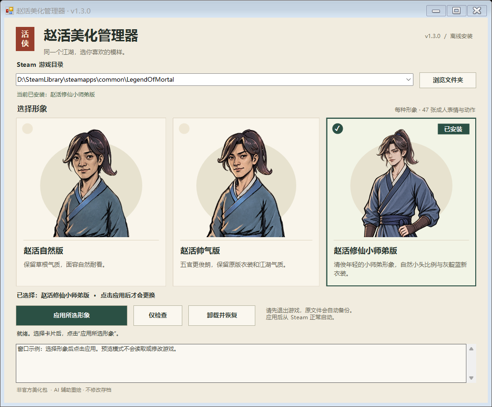

# 《活侠传》赵活美化管理器 v1.3.0

一个离线安装包，三种成人赵活形象：**自然耐看、江湖俊朗、仙侠小师弟**。在同一个窗口选图、检查并应用，不用来回下载不同版本。每种形象包含 47 张表情与动作，游戏中一次只启用所选的一种。

| 赵活自然版 | 赵活帅气版 | 赵活修仙小师弟版 |
| --- | --- | --- |
| 草根侠客气质，面容自然耐看 | 更俊朗的成年侠客，延续原服装与动作 | 清俊年轻的小师弟，更自然的小头身比例与灰靛蓝青衣 |
|  |  |  |

**[下载完整离线安装包](https://github.com/jsdhwfmax/zhaohuo-natural/releases/latest)** · [安装、切换与恢复](docs/形象管理器安装指南.md) · [v1.3.0 更新说明](docs/release-notes-v1.3.0.md)

在发行页选择 **`ZhaoHuoPortraitManager-v1.3.0-win-x64.zip`**。不要把 GitHub 自动生成的 `Source code (zip)` 当作已校验的发行包；源码仓库也包含离线依赖，可供开发者完整检出后运行，但日常安装建议使用有 `ReleaseManifest.json` 和 `SHA256SUMS.txt` 的发行 ZIP。

## 使用方法

1. 完整解压到**游戏目录之外**的独立文件夹，保存进度并退出游戏。
2. 双击 **`打开美化管理器.cmd`**，或兼容入口 `Install.cmd`。
3. 确认 Steam 游戏目录，选择一张形象卡片。选择卡片只改变预览，不写入游戏。
4. 点击“仅检查”，确认通过后点击“应用所选形象”。成功后从 Steam 库启动游戏。

正常安装、文件完整的公开自然版 v1.0.x，以及已知帅气版、修仙小师弟版，可由新管理器识别并升级或切换，**无需先手动卸载**。同一形象重复应用只核对现状。切换共用原插件，只更换受管立绘，保留第一次安装时的原文件备份；回到原游戏外观使用“卸载并恢复”。

手工复制、未知额外文件、缺图或手改文件会被保护并停止自动切换。不要直接往 `BepInEx/plugins` 解压，也不要删安装记录来绕过检查；按[恢复说明](docs/形象管理器安装指南.md#安装器拒绝时怎么处理)处理。

## 兼容与覆盖范围

- Windows x64、Steam 版《活侠传》，随包离线提供官方 BepInEx `6.0.0-be.692` 和 x64 Doorstop。已有匹配的 BepInEx 6 核心及配置会保留；BepInEx 5、未知加载器或冲突文件不会被盲目覆盖。
- 包含 3 × 47＝141 张成人立绘，实际安装所选的 47 张；成人背影及左右剪影仍用原作的 3 张，幼年、老年、魔化、其他角色、战斗小人和剧情 CG 不变。
- 更新游戏后可复用完整包执行“仅检查”。已知构建和完整指纹匹配时快速通过；未知构建使用离线静态接口与资源检查，部分兼容更新可直接使用，关键逻辑或资源变化仍会拒绝。**不保证所有未来更新适配，也不会在每次游戏启动时自动检查。**
- 模组不覆盖游戏原始程序集和资源包，不修改存档、剧情设定或台词。游戏里对赵活外貌的评价不会随立绘改变。

## 验证依据

三套图片与共享插件保持各自已验证版本的字节不变，复用对应实机证据：自然版在 build `25953419` 与 `25957922`，帅气版和小师弟版在 build `25957922` / `release_1.0.6000.2`。三套均通过实际加载与显示组件的 **50 资源、47 替换、属性面板 2 分支**检查；另有普通 Steam 启动记录。

这是使用真实 Addressables、角色和 UI 组件的隔离验证，检查同步/异步加载、UI 引用、缓存和非主角保护；**不是全剧情、全路线通关测试**。小师弟版的普通无自测参数启动持续观察 90.4 秒，帅气版 116 秒。证据分别见[自然版](verification/runtime-build25957922/PASS.txt)、[帅气版](verification/handsome-runtime.json)、[小师弟版](verification/xianxia-runtime.json)。

当前 Windows PowerShell 5.1 下，[管理器专项 98 项](verification/appearance-manager-tests.json)、[安装器回归 74 项](verification/appearance-manager-regression.json)、[GUI/CLI 23 项](verification/appearance-manager-gui.json)均通过。报告绑定当前源码，覆盖六个切换方向、重复应用、失败回滚、文件保护与按钮派发。GUI 使用真实 WinForms 事件加隔离后端，不冒充实际游戏操作。

另外用[真实受管安装的必要文件副本](verification/copied-manager-switch.json)验收“小师弟→自然→帅气→小师弟”及重复应用，核对首次安装记录、已有备份和来源文件。这是 221 个相关文件的隔离副本，不是完整可运行游戏；**该轮未改动正在运行的原游戏。** 三套图片与共享 DLL 的游戏加载验证沿用上面的未变载荷实机证据。构建脚本复核这些代码绑定报告、三套完整指纹、141 张图、离线依赖与兼容探针基线。

## 源码、提示词与反馈

[Source](Source/) 包含共享插件源码；[Prompts](Prompts/) 保存实际绘图记录，使用 builtin imagegen / gpt-image 辅助重绘。只分发本项目替换图和必要依赖，不附带原游戏资源、程序集或存档。

遇到问题可[提交反馈](https://github.com/jsdhwfmax/zhaohuo-natural/issues/new/choose)，附游戏版本、所选形象、完整报错及复现步骤；日志先去除账号和个人路径。原插件名称仍可能显示 `Zhao Huo Natural Portrait`，它是三套形象共用的同一个插件。

本项目免费、非官方，不代表游戏原画作者的新作或官方背书。自有代码与文档见 [MIT License](LICENSE)，美术见[来源与使用说明](ARTWORK-NOTICE.md)，离线依赖见[第三方组件声明](THIRD_PARTY_NOTICES.md)。
