# 《活侠传》角色美化管理器

给唐门换一副你喜欢的江湖模样。

为 **赵活、唐布衣、夏侯兰、唐默铃、龙湘、虞小梅、唐铮** 分别选择立绘，在中文管理器里预览、应用，也能单独恢复原版。**7 位角色 · 14 套自定义外观 · 447 张表情与动作替换图**，可以自由搭配。

免费分享，代码开源。立绘使用 GPT-image 辅助绘制，是非官方玩家模组。

**v2.2.5 修复了管理器查找 Steam 游戏目录时可能出现的“路径中具有非法字符”报错。** 当前支持游戏 1.0.6001.0（Steam build `26237817`）。

| 你手头有什么 | 下载哪个 | 解压后怎么做 |
| --- | --- | --- |
| 保留着 v2.2.1 至 v2.2.4 的完整管理器文件夹 | [v2.2.5 小更新包](https://github.com/jsdhwfmax/zhaohuo-natural/releases/download/v2.2.5/ZhaoHuoPortraitManager-v2.2.5-small-update.zip) | 双击 `双击更新管理器.cmd`，选旧管理器文件夹。新版会建在旁边，原有立绘可以复用。 |
| 首次安装、旧素材已删，或管理器早于 v2.2.1 | [v2.2.5 完整安装包](https://github.com/jsdhwfmax/zhaohuo-natural/releases/download/v2.2.5/ZhaoHuoPortraitManager-v2.2.5-win-x64.zip) | 完整解压到游戏目录外，例如桌面的「活侠传美化」文件夹，双击 `打开美化管理器.cmd`。 |

保存进度并退出游戏，在新版管理器里点“浏览文件夹”，选择含 `Mortal.exe` 的文件夹。先点“仅检查”，通过后再点“应用当前角色”。典型路径和界面操作见[安装教程](docs/形象管理器安装指南.md)，旧用户可直接看[小包更新步骤](docs/小包更新.md)。

分享时可用固定的 [GitHub 最新版入口](https://github.com/jsdhwfmax/zhaohuo-natural/releases/latest)。[百度网盘](https://pan.baidu.com/s/1x2x7BX3lh0Rtwxb31IMobw?pwd=5ije)（提取码 `5ije`）由维护者手动同步，请核对文件名中的版本号。

此前 v2.2.1 修正了大师兄“明艳女侠”的手部方向与手指细节，保留现有画风和造型。 已装旧女版的朋友，退出游戏后用新版管理器选“唐布衣 → 明艳女侠”，检查通过后点“应用当前角色”，即可换上修复图。只打开新版窗口不会自动更新已安装的图片。

## 一个窗口，分别搭配每位角色

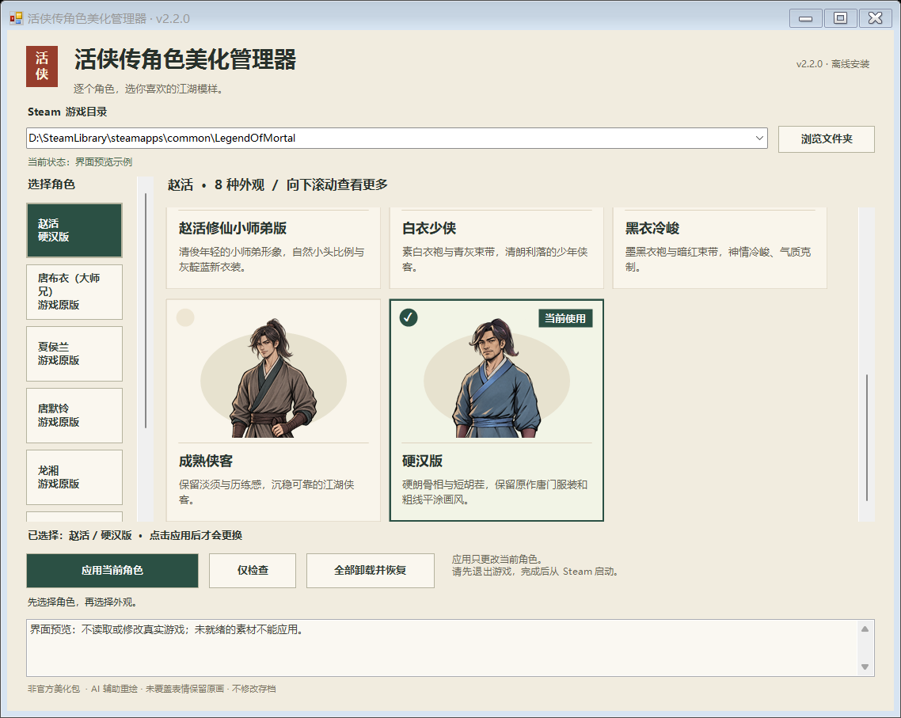

左侧选角色，右侧选外观。点击卡片先看预览，点击“应用当前角色”才会生效。比如赵活用修仙小师弟、大师兄用精修版、夏侯兰保留原版，可以同时使用。

界面图由 v2.2.0 管理器实际绘制，展示最终硬汉版图片；这是界面预览，图中的目录与“当前使用”状态是示例，不代表已读取或修改游戏安装。

## 赵活的七种模样

自然版保留草根侠客的气质；也可以选择更俊朗的帅气版、修仙小说小师弟，或白衣、黑衣、成熟侠客。新增硬汉版，肩背更厚实、面部轮廓更硬朗。各套包含 47 张表情与动作替换图。

| 自然版 | 帅气版 | 修仙小师弟 |
| --- | --- | --- |
| 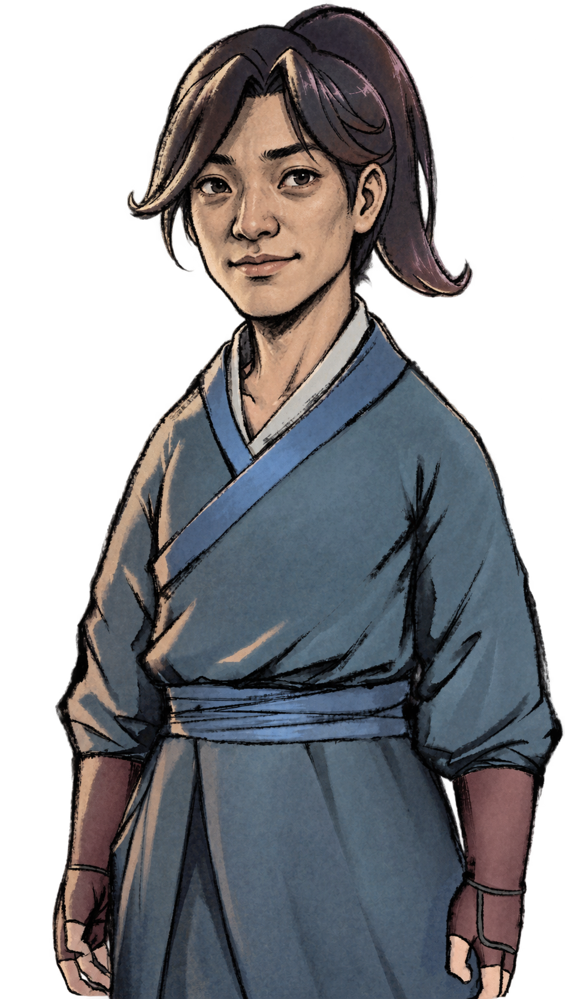 | 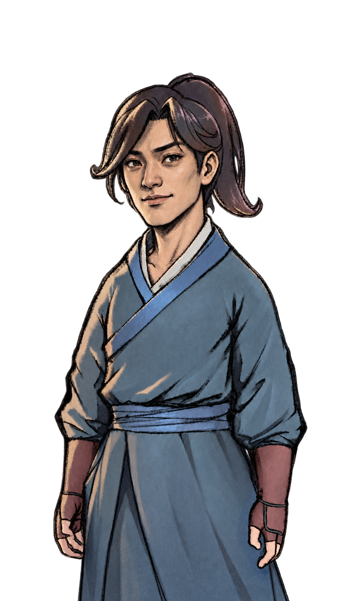 | 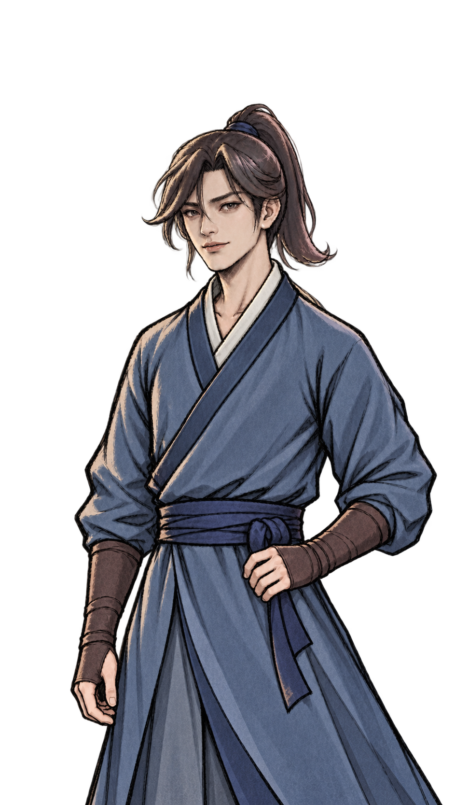 |

| 白衣少侠 | 黑衣冷峻 | 成熟侠客 |
| --- | --- | --- |
| 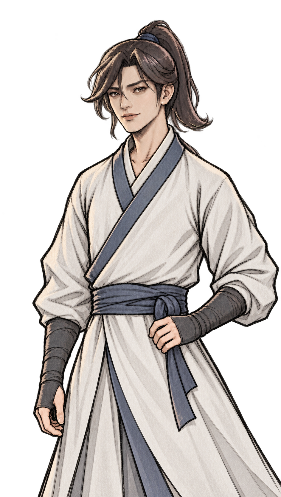 | 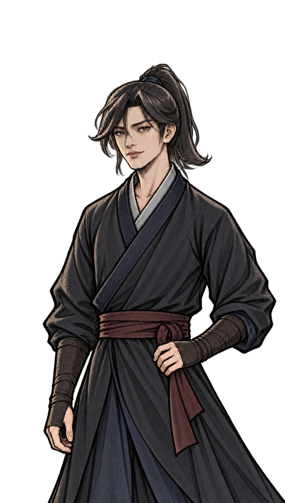 | 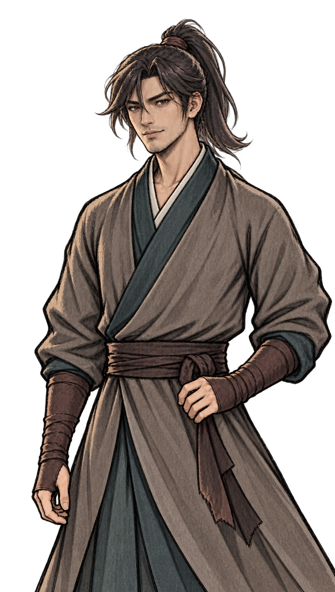 |

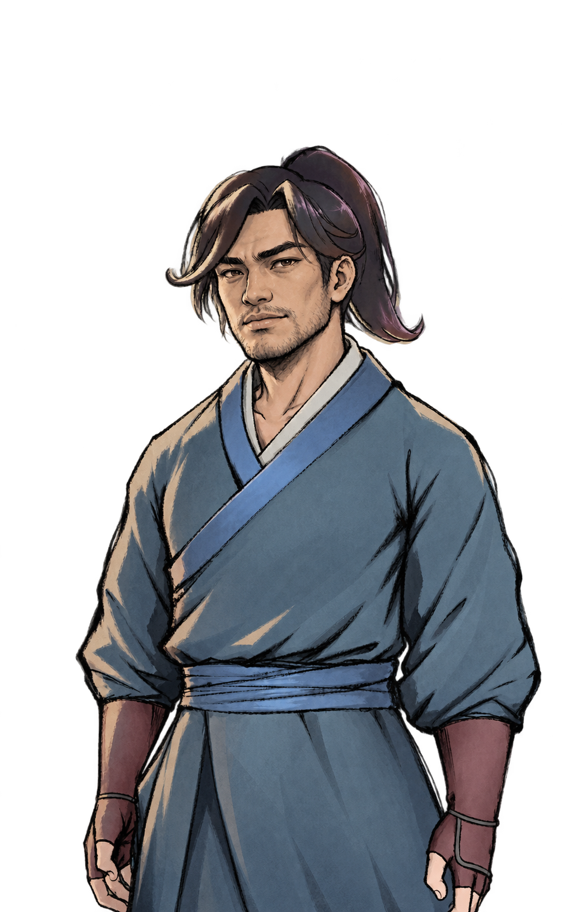

## 女主与师兄也能单独选择

| 夏侯兰·精修 | 唐默铃·精修 | 龙湘·精修 | 虞小梅·精修 |
| --- | --- | --- | --- |
| 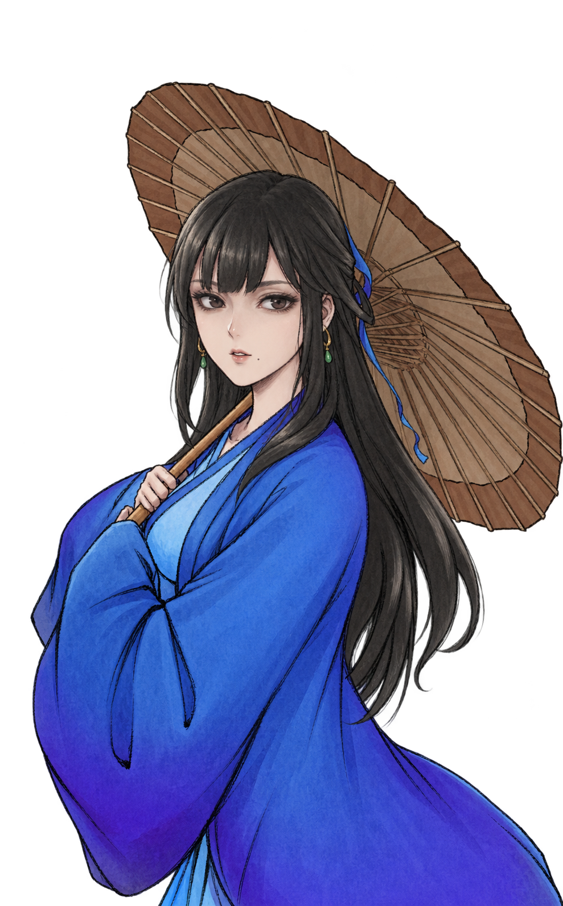 | 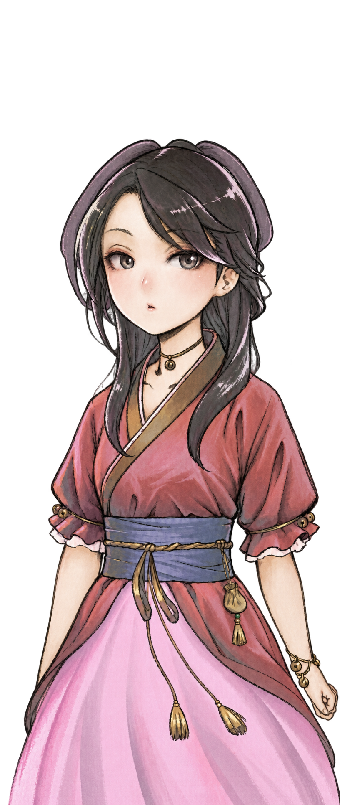 | 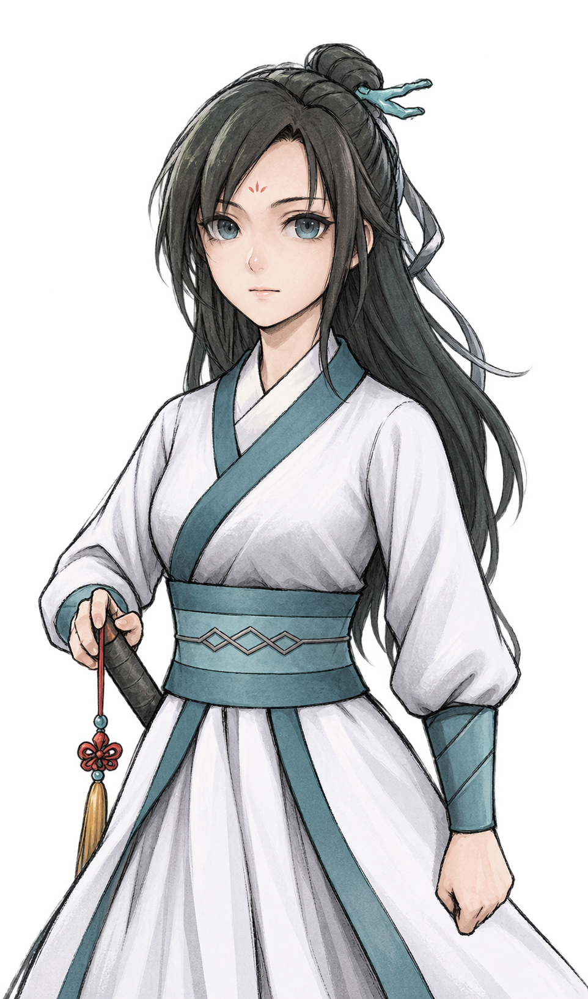 | 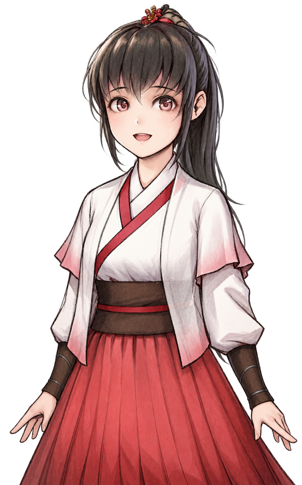 |

| 唐布衣·精修 | 唐布衣·明艳女侠 | 唐铮·冷艳女侠 |
| --- | --- | --- |
| 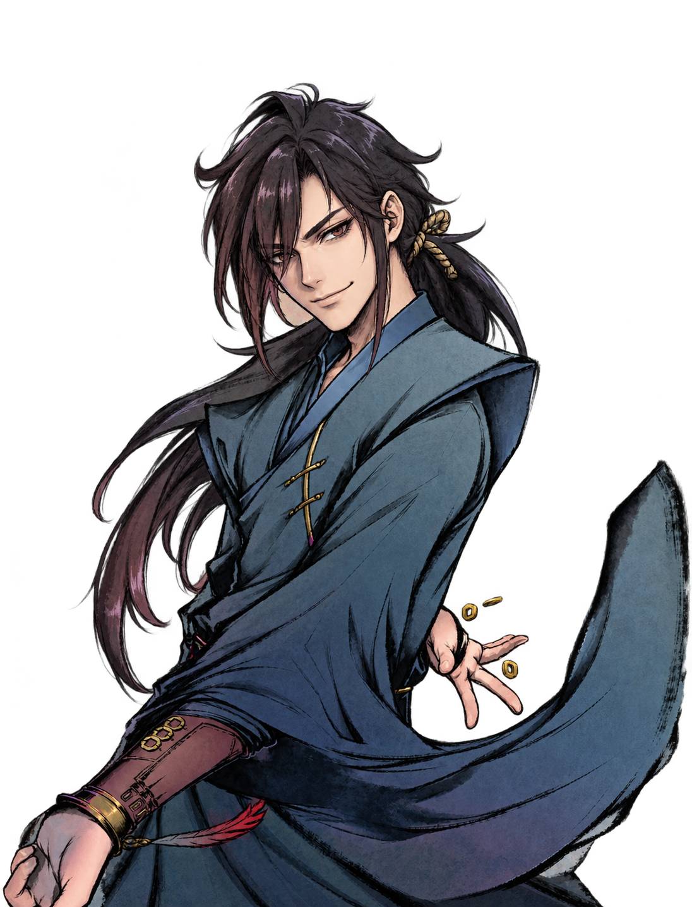 | 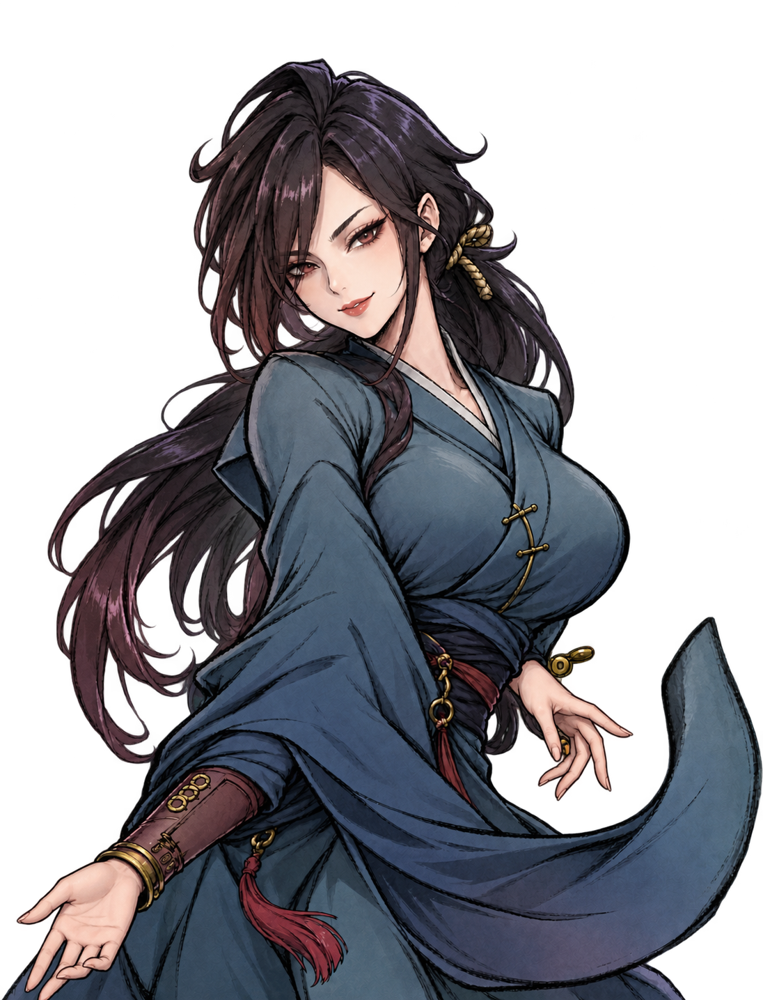 | 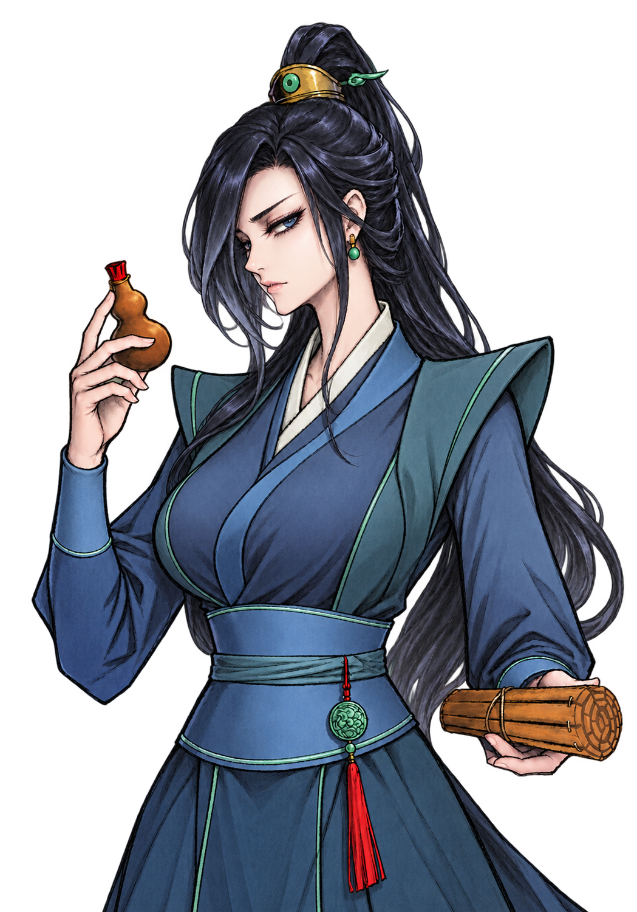 |

两位师兄的女版是可选立绘，**不修改剧情性别、称呼、对白或人物关系**。剧情里对赵活外貌的评价也保持原样。

查看师兄切换界面与完整数量

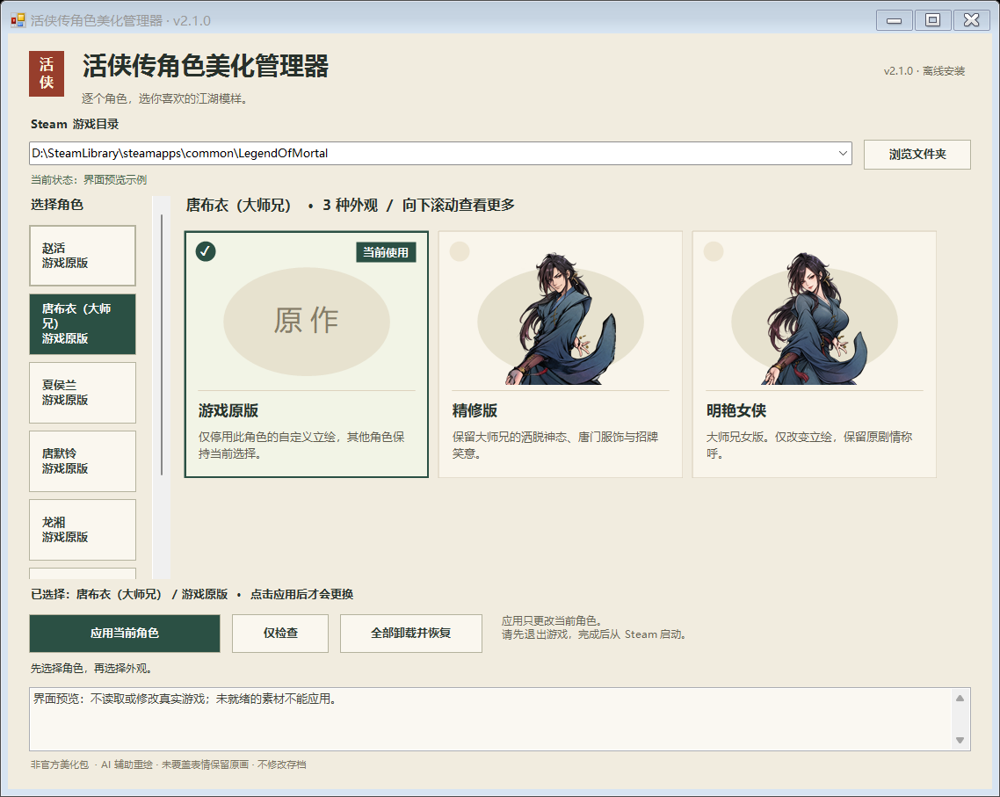

| 角色 | 自定义外观 | 替换图数量 |
| --- | --- | ---: |
| 赵活 | 自然、帅气、修仙小师弟、白衣少侠、黑衣冷峻、成熟侠客、硬汉 | 7 × 47 |
| 唐布衣（大师兄） | 精修、明艳女侠 | 2 × 15 |
| 夏侯兰 | 精修 | 15 |
| 唐默铃（小师妹） | 精修 | 15 |
| 龙湘 | 精修 | 21 |
| 虞小梅 | 精修 | 25 |
| 唐铮（二师兄） | 冷艳女侠 | 12 |

合计 14 套自定义外观、447 张替换图，另有 7 个独立的“游戏原版”选项。

## 下载后怎么用

1. 下载完整安装包，**完整解压到游戏目录之外**。
2. 保存进度并退出游戏，双击 `打开美化管理器.cmd`。
3. 点击“浏览文件夹”，选择包含 `Mortal.exe` 的 Steam 游戏文件夹，再选择角色和外观。不要选 `Mortal_Data`，也不要选解压出来的管理器文件夹。
4. 点击“仅检查”，通过后点击“应用当前角色”。其他角色需要分别应用。
5. 从 Steam 库正常启动游戏。

完整包已附带运行依赖，安装和检查可离线完成。切换前也请退出游戏，应用后重新启动。

**已经装过我们的旧版？** 有完整安装记录、受管文件和首次备份的正常旧版，可以用新管理器直接检查并应用；会保留原有选择和最初备份，无需先卸载。手工复制、未知来源或记录受损的安装不自动迁移，按窗口提示处理。详见[升级说明](docs/形象管理器安装指南.md#从旧包升级)。

**想恢复原画？** 选中该角色的“游戏原版”并应用即可。要恢复整个模组首次安装前的状态，使用“全部卸载并恢复”。

## 适配范围

- Windows x64，Steam 版《活侠传》。当前公开版本是 **Steam build `26237817` / `release_1.0.6001.0`**。v2.2.5 沿用 v2.2.4 验证过的游戏兼容规则。此前实测的 build 包括 `26073097`、`26021712`、`25987745`、`25957922` 和 `25953419`。
- 主要替换白名单角色的成人剧情立绘，不修改存档、剧情、台词和数值，不覆盖原游戏程序集或资源包。
- 单独手部、指定背影/剪影，以及虞小梅两张含赵活的合绘保留原画。1.0.6.03 为虞小梅新增的 `doubt` 表情也保留原画。NPC 社交小头像、战斗小人、剧情 CG 和未纳入的独立造型不在替换范围内。
- 游戏更新后，退出游戏并运行管理器的“仅检查”。**符合已有完整资源与代码核验规则的小更新可直接继续使用**；检查到关键逻辑、依赖或资源变化时会停止，需要新版适配。检查不联网，不是每次启动游戏自动检查，也不会自动下载或修补未来版本。

v2.2.4 在 build `26237817` 上测试了七位角色各一款外观（共 150 张替换图），也测试了七角色全原画。恢复原选择后，从 Steam 正常启动并观察了 91.6 秒。该轮未加载剧情存档。v2.2.5 继续使用这套立绘、布局和运行插件 v2.1.0。[游戏适配记录](docs/build26237817适配说明.md)

此前 v2.2.1 替换唐布衣女版的 15 张完整表情图，其余 432 张 PNG、运行插件 v2.1.0、布局和游戏兼容规则保持原字节。安装器增加对旧女版完整安装的识别，方便直接更新并保留原有选择与首次备份。该版本已在 1.0.6.03 完成女版、男版、原画三组实机诊断，15 张修复图逐张检查通过，普通 Steam 启动观测 90.7 秒通过；测试后恢复原有七位角色选择。详见[验证记录](verification/README.md)。

此前 v2.2.0 已在 1.0.6.03 完成四组实际游戏诊断，覆盖 9 套代表外观及 7 位角色的原版模式；普通 Steam 启动观测 92 秒通过。未变素材继续保留[该轮历史报告](verification/runtime-build25987745/compatibility-runtime.json)，它不代替本次 build `26237817` 验证。测试未加载剧情存档，也不代表全剧情或全路线通关。

## 源码、反馈与使用说明

- 维护者从源码构建完整发行包时，需要把 Python 3.11 或更高版本加入 PATH，再运行[打包脚本](scripts/Build-Release.ps1)。玩家下载现成的安装包即可。
- [插件源码与构建](Source/README.md)：C# 插件及本地构建步骤。
- [管理器与安装脚本](installer/) · [绘图提示与来源记录](Prompts/) · [版本记录](CHANGELOG.md)。
- [反馈问题](https://github.com/jsdhwfmax/zhaohuo-natural/issues/new/choose)：附游戏版本、角色、所选外观和复现步骤；日志先去除账号与个人路径。

代码、原创脚本与文档按 [MIT License](LICENSE) 开源。立绘的来源与使用范围见 [ARTWORK-NOTICE](ARTWORK-NOTICE.md)，依赖许可见[第三方声明](THIRD_PARTY_NOTICES.md)。原游戏与角色相关权利归原权利人，本项目不包含原版游戏、原始资源包或存档，也没有官方背书。
