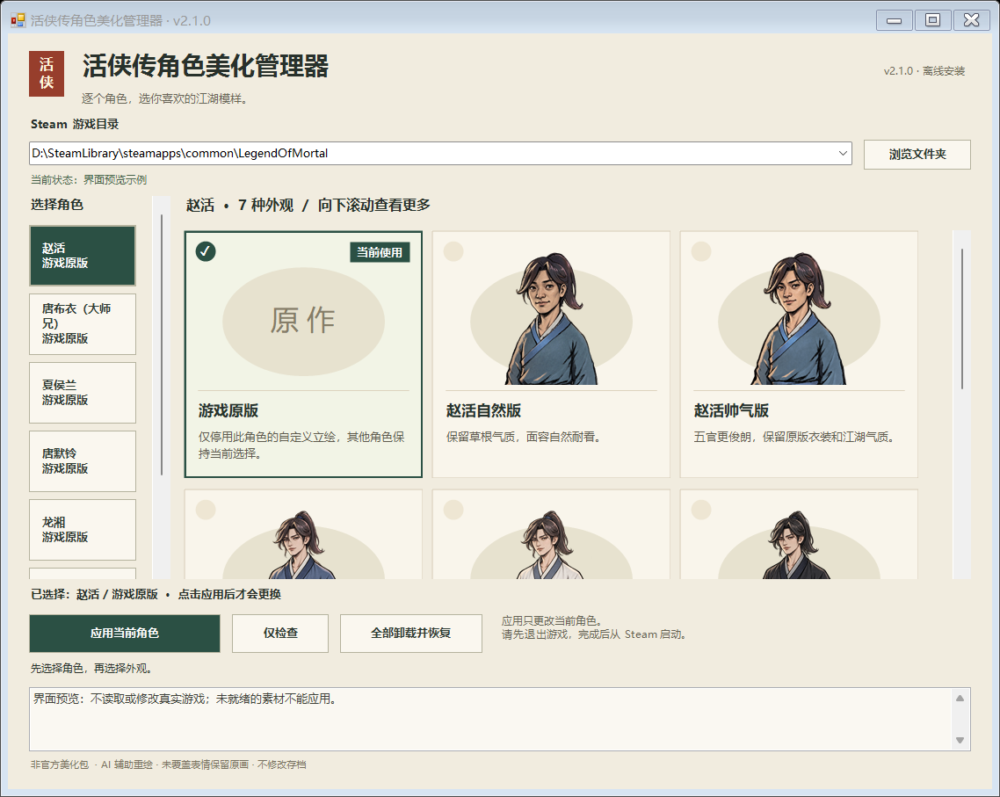

# 《活侠传》角色美化管理器

给唐门换一副你喜欢的江湖模样。

为 **赵活、唐布衣、夏侯兰、唐默铃、龙湘、虞小梅、唐铮** 分别选择立绘，在中文管理器里预览、应用，也能单独恢复原版。**7 位角色 · 13 套自定义外观 · 400 张表情与动作替换图**，可以自由搭配。

免费分享，代码开源。立绘使用 GPT-image 辅助绘制，是非官方玩家模组。

**[下载最新版完整安装包](https://github.com/jsdhwfmax/zhaohuo-natural/releases/latest)** · **[百度网盘](https://pan.baidu.com/s/1bMhWtbV8NdyA4PeGvPkxUA?pwd=76em)** · [安装与切换教程](docs/形象管理器安装指南.md) · [常见问题](docs/角色管理器常见问题.md)

当前完整包：`ZhaoHuoPortraitManager-v2.1.0-win-x64.zip`，约 657 MiB。请下载 Release 的这个附件；`Source code` 是源码归档，不是玩家安装包。以后分享上方的 **`releases/latest`** 链接，就能进入最新正式版。

## 一个窗口，分别搭配每位角色

左侧选角色，右侧选外观。点击卡片先看预览，点击“应用当前角色”才会生效。比如赵活用修仙小师弟、大师兄用精修版、夏侯兰保留原版，可以同时使用。

界面图为 v2.1.0 预览示例；实际游戏目录与安装状态以你的电脑为准。

## 赵活的六种模样

自然版保留草根侠客的气质；也可以选择更俊朗的帅气版、修仙小说小师弟，或白衣、黑衣、成熟侠客。各套包含 47 张表情与动作替换图。

| 自然版 | 帅气版 | 修仙小师弟 |
| --- | --- | --- |
|  |  |  |

| 白衣少侠 | 黑衣冷峻 | 成熟侠客 |
| --- | --- | --- |
|  |  |  |

## 女主与师兄也能单独选择

| 夏侯兰·精修 | 唐默铃·精修 | 龙湘·精修 | 虞小梅·精修 |
| --- | --- | --- | --- |
|  |  |  |  |

| 唐布衣·精修 | 唐布衣·明艳女侠 | 唐铮·冷艳女侠 |
| --- | --- | --- |
|  |  |  |

两位师兄的女版是可选立绘，**不修改剧情性别、称呼、对白或人物关系**。剧情里对赵活外貌的评价也保持原样。

查看师兄切换界面与完整数量

| 角色 | 自定义外观 | 替换图数量 |
| --- | --- | ---: |
| 赵活 | 自然、帅气、修仙小师弟、白衣少侠、黑衣冷峻、成熟侠客 | 6 × 47 |
| 唐布衣（大师兄） | 精修、明艳女侠 | 2 × 15 |
| 夏侯兰 | 精修 | 15 |
| 唐默铃（小师妹） | 精修 | 15 |
| 龙湘 | 精修 | 21 |
| 虞小梅 | 精修 | 25 |
| 唐铮（二师兄） | 冷艳女侠 | 12 |

合计 13 套自定义外观、400 张替换图，另有 7 个独立的“游戏原版”选项。

## 下载后怎么用

1. 下载完整安装包，**完整解压到游戏目录之外**。
2. 保存进度并退出游戏，双击 `打开美化管理器.cmd`。
3. 确认包含 `Mortal.exe` 的 Steam 游戏目录，选择角色和外观。
4. 点击“仅检查”，通过后点击“应用当前角色”。其他角色需要分别应用。
5. 从 Steam 库正常启动游戏。

完整包已附带运行依赖，安装和检查可离线完成。切换前也请退出游戏，应用后重新启动。

**已经装过我们的旧版？** 有完整安装记录、受管文件和首次备份的正常旧版，可以用新管理器直接检查并应用；会保留原有选择和最初备份，无需先卸载。手工复制、未知来源或记录受损的安装不自动迁移，按窗口提示处理。详见[升级说明](docs/形象管理器安装指南.md#从旧包升级)。

**想恢复原画？** 选中该角色的“游戏原版”并应用即可。要恢复整个模组首次安装前的状态，使用“全部卸载并恢复”。

## 适配范围

- Windows x64，Steam 版《活侠传》；已验证“崆峒神威”更新的 Steam build `25957922` / `release_1.0.6000.2`。
- 主要替换白名单角色的成人剧情立绘，不修改存档、剧情、台词和数值，不覆盖原游戏程序集或资源包。
- 单独手部、指定背影/剪影，以及虞小梅两张含赵活的合绘保留原画。NPC 社交小头像、战斗小人、剧情 CG 和未纳入的独立造型不在替换范围内。
- 游戏更新后，退出游戏并运行管理器的“仅检查”。**部分兼容更新可继续使用，关键逻辑或资源变化仍需适配**；不是每次启动游戏自动检查，也不保证所有未来版本通用。

实际验收包括安装升级、新 DLL 的三组资源诊断、八套代表外观、七角色原版模式及普通 Steam 启动。其余五套赵活图片保持原字节并沿用历史美术证据，未声称在新 DLL 下逐套重测；没有进行全剧情或全路线通关测试。详细记录见[安装验收](verification/character-installation.json)、[实机验收](verification/character-runtime.json)和[验证目录](verification/README.md)。

## 源码、反馈与使用说明

- [插件源码与构建](Source/README.md)：C# 插件及本地构建步骤。
- [管理器与安装脚本](installer/) · [绘图提示与来源记录](Prompts/) · [版本记录](CHANGELOG.md)。
- [反馈问题](https://github.com/jsdhwfmax/zhaohuo-natural/issues/new/choose)：附游戏版本、角色、所选外观和复现步骤；日志先去除账号与个人路径。

代码、原创脚本与文档按 [MIT License](LICENSE) 开源。立绘的来源与使用范围见 [ARTWORK-NOTICE](ARTWORK-NOTICE.md)，依赖许可见[第三方声明](THIRD_PARTY_NOTICES.md)。原游戏与角色相关权利归原权利人，本项目不包含原版游戏、原始资源包或存档，也没有官方背书。
