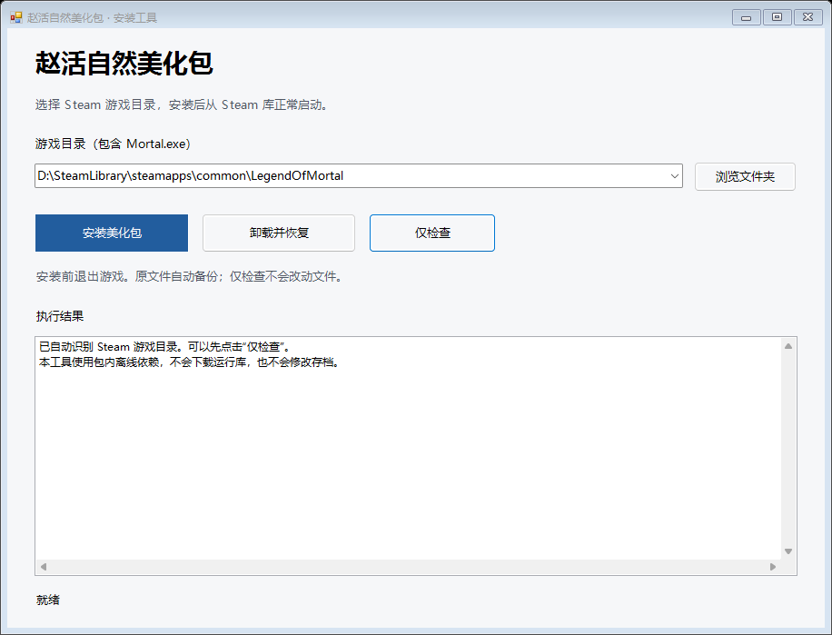

# 安装与卸载

本说明面向发布页提供的完整安装包。源码快照不是安装包。适用版本与已验证范围请先阅读[兼容性与验证](兼容性与验证.md)。

## 下载与准备

1. 从[最新发布页](https://github.com/jsdhwfmax/zhaohuo-natural/releases/latest)下载完整安装包 ZIP。v1.0.2 的文件名为 `ZhaoHuoNatural-v1.0.2-build25957922-win-x64.zip`，请在发布页 **Assets** 中选择它；不要只取旧包里的安装脚本。
2. 完整解压到**游戏目录之外**的独立文件夹。不要直接在压缩包里运行，也不要只取出 `Install.cmd`；脚本、图片和依赖需要一起保留。
3. 在游戏内正常保存进度并退出，确认游戏不再运行。

完整安装包包含所需的 BepInEx、Doorstop、兼容检查工具及基线，检查与安装过程可离线完成，无需另外寻找运行库或安装检查依赖。安装包不含游戏或原版立绘，需要先通过 Steam 安装正版《活侠传》。

## 旧版升级到 v1.0.2

首次从 v1.0.0 或 v1.0.1 升级时，请下载 v1.0.2 完整 ZIP，退出游戏，完整解压到游戏目录之外，再运行**新文件夹中的** `Install.cmd`。旧包不包含新增检查工具，仅重新解压旧包或复制新版单个脚本不能获得这项功能。

v1.0.2 沿用相同的插件和 47 张立绘。已有安装文件、记录与加载环境保持完整时，直接点击“仅检查”或“安装美化包”，新安装器会重新核对游戏并提示已经安装，**无需先卸载，也不会重复覆盖或改写原安装记录**。若文件被修改或缺失，请按安装器提示先卸载再安装，并保留备份。

若曾把安装包直接解压进游戏目录，请先从新版完整 ZIP 解压一份到游戏目录之外，再从外部文件夹运行安装器。对于没有安装记录、但专用插件目录内的文件数量、路径和全部内容与发行包完全一致的情况，安装器会先备份，再纳入正常安装管理；出现额外文件或内容变化时仍会停止，请勿盲目手动删除 DLL。此类接管安装卸载时会恢复本次安装前状态，因此原先手工解压进去的插件文件会保留。

## 安装

安装窗口示意，实际路径以你的电脑为准。

1. 双击 `Install.cmd` 打开中文安装窗口。
2. 确认检测到的《活侠传》目录。只有一个结果时会自动填入；有多个结果时，请从下拉列表选择。若没有找到，使用窗口中的浏览功能选择**包含 `Mortal.exe` 的游戏文件夹**；不要选择 `Mortal_Data` 子目录。
3. 点击“**仅检查**”，阅读窗口中显示的游戏版本与加载环境结果。版本不匹配、缺少文件或加载器不受支持时，停止安装并保留提示内容。
4. 通过检查后点击“**安装美化包**”。等窗口明确报告成功，再关闭安装器。
5. 从 Steam 正常启动游戏，查看成人赵活的对话立绘或属性面板。

安装器按检查结果处理环境：

- **纯净游戏：**添加包内的官方 BepInEx `6.0.0-be.692` Mono 运行库、配置和 Doorstop x64 加载器。
- **已有 BepInEx：**核心 DLL 必须与已验证的 be.692 一致，Doorstop 配置也须符合要求；安装器保留已有核心与配置，只安装本包并处理兼容加载器。
- **不兼容环境：**BepInEx 5、未知加载器、不完整或不匹配的核心，以及不受支持的配置会停止安装。IL2CPP 环境不在支持范围内。

若检测到旧插件 `BepInEx/plugins/Tianfei/MortalBeauty.dll`，安装器会先备份，再将它停用，避免同时替换立绘；旧图片保留。其他美化包仍需自行确认，检查通过不代表所有模组组合均兼容。

## 安装后的文件

立绘插件与新图片位于游戏目录中的 `BepInEx/plugins/ZhaoHuoNatural/`。插件在运行时替换图片，不覆盖原始游戏程序集、资源包或存档。

安装记录位于 `BepInEx/ZhaoHuoNatural-install/ActiveManifest.json`，本次备份位于同目录的 `Backups/<安装编号>/`。这些路径都相对于游戏目录。

请保留安装包、安装记录及备份。它们用于核对本次安装和卸载回滚；不要自行删除或修改备份中的内容。若已有其他模组，不要将整个 `BepInEx` 文件夹当作本包文件一并删除。

安装后的插件仍显示 `1.0.0` 是正常情况：`1.0.2` 是包含新安装器与检查工具的发行包版本，插件 DLL 本身没有改动。

## 卸载

1. 正常退出游戏。
2. 双击原发布包中的 `Uninstall.cmd`。
3. 确认正确的游戏目录，点击“**卸载并恢复**”，等候完成提示。
4. 再从 Steam 启动游戏检查恢复情况。

`Install.cmd` 与 `Uninstall.cmd` 打开同一个中文窗口。卸载入口会将焦点放到“卸载并恢复”，不会在打开窗口时自动卸载。

卸载按安装记录逐个移除本包添加的文件，并恢复被替换的加载器及本包停用的旧插件。安装后修改过的受管文件会先保留到 `Backups/<安装编号>/Preserved-*/`；运行验证生成的 `Diagnostics` 也会移入该处。其他新增文件保留，不会整个删除模组目录。

**如果安装前是纯净游戏，卸载会移除本包添加的运行库。** 后来安装的其他模组文件仍会保留，但它们若依赖这套运行库，需要另外重新安装兼容运行库。安装前已经存在的受支持 BepInEx 核心与配置不由本包删除。

没有活动安装记录时，卸载器不会改动文件。若提示备份缺失、记录无效或无法恢复，请保留当前文件和提示，参考[常见问题](常见问题.md)联系维护者，不要继续手动覆盖。安装中途失败时会尝试自动回滚；若回滚未完成，解决提示的问题后再次运行“卸载并恢复”。

## 命令行入口

习惯使用 PowerShell 的用户也可调用 `Install.ps1 -GamePath <游戏目录> -CheckOnly` 进行只读检查，去掉 `-CheckOnly` 执行安装。`Uninstall.ps1` 支持同样的 `-GamePath` 和 `-CheckOnly` 参数。

不指定目录时，命令行只在找到唯一 Steam 候选目录时自动选择。存在多个候选目录时，请使用中文窗口选择，或明确传入 `-GamePath`。普通玩家直接使用 `.cmd` 入口即可。

## 游戏升级或移动目录

游戏更新后，可复用已经下载并完整保留的 v1.0.2 文件夹：

1. 等待 Steam 更新结束，并退出游戏。
2. 从游戏目录之外保留的完整包中运行 `Install.cmd`，选择正确的游戏目录，点击“仅检查”。
3. 阅读结果。匹配已验证指纹或通过离线兼容检查，并且已安装文件完整时，无需重复安装，可从 Steam 正常启动。
4. 如检查提示关键接口、实现、资源变化或无法完成检查，请保留原因，到[最新发布页](https://github.com/jsdhwfmax/zhaohuo-natural/releases/latest)查看适配情况；不要删掉检查代码、替换游戏 DLL 或强行混装。

离线检查由安装器触发，游戏启动时不会自动运行。它主要支持游戏资源包保持不变、立绘依赖逻辑未变且符合其余基线条件的代码热修复；剧情或资源包变化也可能被保守拒绝，未通过时可能仍需新版安装包。未知构建会进行完整资源校验，可能稍久，请等候结果。点击“仅检查”不会修改游戏文件。

移动游戏目录前建议先卸载本包，避免安装记录中的路径失效。游戏插件不会阻止 Steam 更新，旧文件仍在目录中不等于当前游戏已通过兼容检查。

## 确认是否加载

正常游玩无需任何测试启动参数。在游戏目录的 `BepInEx/LogOutput.log` 中搜索 `Zhao Huo Natural Portrait`，可确认插件加载记录。

如果只看未覆盖的幼年、老年、CG 或战斗小人，外观保持原样是预期行为。若覆盖范围内也没有变化，先执行安装器检查，再参考[常见问题](常见问题.md)。
